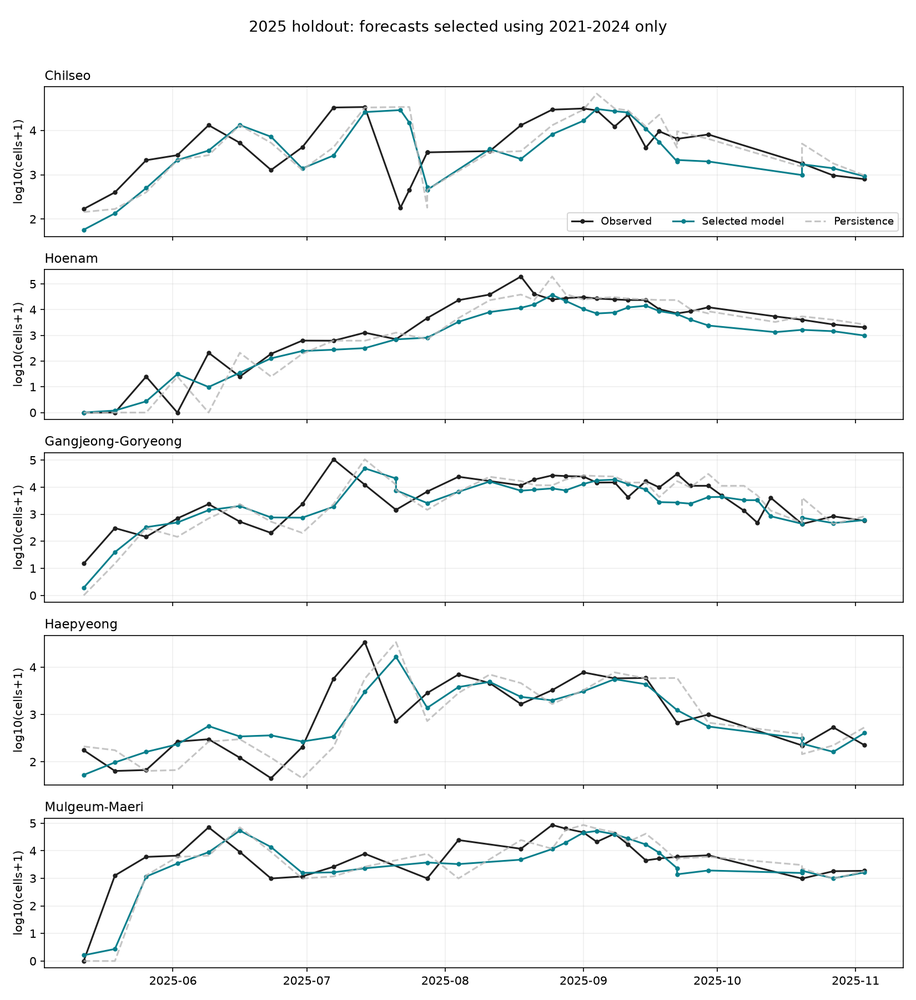

# 실제 학습·검증 결과

## 실행 범위와 선택

- 76개 특징, 44회 과거 연도 검증, 11개 설정을 실행했다.
- 2021~2024년을 각각 미래 검증 연도로 두고, 해당 연도 시작 전에 정답이 관측된 공식 train만 학습했다.
- 선택 기준은 5~10월 log10(y+1) RMSE의 연도별 동일 가중 평균이다. 공식 종합점수의 결합 방식은 미확인이다.
- 웹 문제 설명의 과거 예시와 분할·배점이 달라, 제공된 실제 데이터 README의 회귀 100% 및 train~2024/valid2025/test2026 구분을 적용했다.
- 과거 검증 상위 3개 후보의 단독 예측과 두 모델의 25/50/75% 로그 예측 혼합을 비교했다. 미세한 개선으로 복잡도를 늘리지 않도록 0.002 개선 기준을 적용했다.
- 2025년 결과를 보기 전에 선택을 파일로 고정했다. 2025년 결과로 모델·비중을 다시 고르지 않았다.

선택 모델:

- `tabpfn_delta_full_all_2012`: 50%
- `lightgbm_delta_full_all_2017`: 50%

선택 예측의 과거 검증 RMSE 평균: **0.7383**.
`delta`는 최신 관측 log10(y+1) 대비 변화량, `direct`는 미래 log10(y+1)을 직접 예측한다. 혼합도 로그 공간에서 수행한다.

## 과거 검증 비교

| tag | folds | RMSE | MAE | R2 |
| --- | --- | --- | --- | --- |
| tabpfn_delta_full_all_2012 | 4 | 0.7452 | 0.5480 | 0.1274 |
| lightgbm_delta_full_all_2017 | 4 | 0.7561 | 0.5592 | 0.0685 |
| lightgbm_delta_full_warm_2012 | 4 | 0.7799 | 0.5844 | 0.1187 |
| lightgbm_delta_full_all_2012 | 4 | 0.7808 | 0.5871 | -0.0311 |
| catboost_delta_full_all_2012 | 4 | 0.7809 | 0.5913 | 0.0219 |
| tabpfn_direct_full_all_2012 | 4 | 0.7833 | 0.5850 | 0.0482 |
| lightgbm_delta_water_all_2012 | 4 | 0.7847 | 0.5995 | 0.0081 |
| lightgbm_delta_algae_all_2012 | 4 | 0.7853 | 0.6093 | -0.0200 |
| lightgbm_direct_full_all_2012 | 4 | 0.7890 | 0.5998 | 0.0539 |
| catboost_direct_full_all_2012 | 4 | 0.7919 | 0.6018 | 0.0534 |
| lightgbm_delta_weather_all_2012 | 4 | 0.7981 | 0.6049 | 0.0057 |

`all`은 전 계절 학습, `warm`은 4~11월 학습이다. 마지막 숫자는 학습 시작 연도다.
특징은 algae → water → weather → full 순서로 누적된다. 각 행은 같은 네 검증 연도의 평균이며 R²는 원 단위 기준이다.
여러 설정을 비교해 선택한 CV 수치에는 선택 편향이 있을 수 있으므로 아래 별도 검증 결과를 함께 봐야 한다.

## 2025년 별도 검증

| scope | model | n | rmse_log10 | mae_log10 | r2_nse |
| --- | --- | --- | --- | --- | --- |
| all | selected | 256 | 0.7654 | 0.5550 | 0.1076 |
| all | persistence | 256 | 0.8910 | 0.5858 | -0.2800 |
| all | tabpfn_delta_full_all_2012 | 256 | 0.7753 | 0.5334 | 0.1731 |
| all | lightgbm_delta_full_all_2017 | 256 | 0.7827 | 0.5911 | 0.0390 |
| all | lightgbm_delta_full_warm_2012 | 256 | 0.7859 | 0.5849 | 0.0633 |
| May_Oct | selected | 151 | 0.6335 | 0.4769 | 0.0060 |
| May_Oct | persistence | 151 | 0.6970 | 0.4896 | -0.4258 |
| May_Oct | tabpfn_delta_full_all_2012 | 151 | 0.6079 | 0.4481 | 0.0790 |
| May_Oct | lightgbm_delta_full_all_2017 | 151 | 0.6853 | 0.5276 | -0.0705 |
| May_Oct | lightgbm_delta_full_warm_2012 | 151 | 0.6702 | 0.5151 | -0.0434 |

`persistence`는 최신 유효 관측값을 그대로 예측한 기준선이다. `May_Oct`는 5~10월, `all`은 전체 256행이다.
모델 선택 기준은 로그 오차이므로 원 단위 극단값의 R²가 함께 개선된다고 보장되지 않는다.

2025년 5~10월에는 TabPFN 단독 RMSE가 0.6079로 고정 앙상블의 0.6335보다 좋았다. 이 결과를 보고 기존 선택을 바꾸지는 않았다. 앙상블은 최신값 유지 기준선보다 로그 RMSE가 약 9.1% 낮지만, 원 단위 R²는 약 0.006으로 급증 크기를 예측하는 능력은 여전히 제한적이다. 그래프에서도 여러 지점의 급격한 상승·하락을 늦게 따라가는 모습이 남아 있다.

지점별 5~10월 성능:

| station | n | rmse_log10 | mae_log10 | r2_nse |
| --- | --- | --- | --- | --- |
| CS | 30 | 0.6847 | 0.5086 | 0.0505 |
| DCHN | 32 | 0.6080 | 0.4761 | 0.0076 |
| GJGR | 36 | 0.6025 | 0.4831 | -0.2323 |
| HP | 25 | 0.5264 | 0.3810 | -0.1302 |
| MGMR | 28 | 0.7248 | 0.5216 | -0.0328 |

## 검증과 제출 초안

- 미래 관측 변조, 목표 날짜 변조, 당일 기상·수문 차단, 조류 결측 시 이전 관측 대체, 학습 정답 날짜 경계의 5개 테스트 통과.
- 저장 모델을 다시 읽은 예측이 저장 전 예측과 일치함을 확인했다.
- 원본 ZIP에서 특징을 다시 계산한 독립 추론 결과와 제출 초안이 동일한지 확인한 결과: **True**.
- `submission_draft.csv`: 124행, 원본 양식의 키·순서 유지, 비음수 정수 예측.
- test 정답은 학습·모델 선택·성능 평가에 사용하지 않았다. 외부 제출은 하지 않았다.

## 해석과 남은 제한

1. 이번 TabPFN은 **공개 v2 가중치, CPU, estimator 1개**다. 최신 버전이나 충분한 앙상블을 사용한 TabPFN 전체의 성능으로 일반화하지 않는다.
2. 과거 기간을 줄인 LightGBM의 개선이 모든 연도에서 균일하지는 않다. 해당 기간 선택 역시 네 연도 CV 안에서 수행했다.
3. 각 예측 기준일에 조류·수질 관측 결과를 사용할 수 있다고 가정했다. 실제 공표 지연이 있으면 추가 지연 처리가 필요하다. 기상·수문은 전날까지 사용했다.
4. 2026년 관측도 각 기준일까지 공개된 입력으로만 사용했다. 테스트 구간 전체 관측을 한 번에 미리 아는 조건으로 계산하지 않았다.
5. 강수 결측은 무강수로 확정하지 않고 관측 합과 관측 비율을 함께 입력했다. 수문은 두 댐의 보수적인 신호이며 전체 하천망이나 이동 시간을 표현하지 않는다.
6. valid를 최종 학습에 합쳐도 되는지 확인되지 않아 제출 초안은 2024년까지의 공식 train만 학습한 모델이다. 2025년까지 재학습한 최종 모델은 별도 규칙 확인 후 만들 수 있다.
7. 공식 종합 평가식, 외부 사전학습 모델 허용 여부 및 자료 공개 시점 조건을 확인한 뒤 실제 제출에 사용해야 한다.

재현 명령은 [README](../README.md), 고정 선택은 [selection.json](../artifacts/selection.json), 전체 실행 기록은 [run_summary.json](run_summary.json)에 있다.
